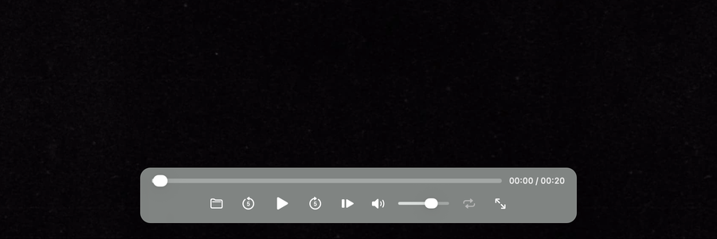

# Bink Player for Mac

Play Bink 2 (`.bk2`) and Bink (`.bik`) video files on macOS, with normal player controls: play/pause, a seek bar, ±5s skip, volume, loop and fullscreen. Double-click a `.bk2` in Finder and it opens like any other video.

<p align="center">
  <a href="https://discord.gg/reADpA6Cd"></a>
  <br />
  <sub>Questions, previews, bug reports and format research. Come say hi.</sub>
</p>



Bink is the video format a lot of games use for cutscenes, intros and in-game screens. QuickTime, VLC, IINA, mpv and FFmpeg can't decode Bink 2, so on a Mac the only option was RAD's own free player, which has no UI at all (no seek bar, no pause button, and it quits when the video ends). This project wraps that player with a QuickTime-style HUD.

It's only the player. No game files or videos are included.

## Features

- Seek bar with exact seeking, even in videos that only have a single keyframe (common in game files)
- ±5s skip that stacks when you press it repeatedly
- Volume slider and mute, plus the arrow keys
- Plays every audio track in the file. Many game videos store audio under track IDs other than 0, and RAD's player plays those silently
- Stops on the last frame like QuickTime, or loops if you turn loop on (remembered between launches)
- Window sized to the video's aspect ratio, so vertical videos don't get black bars
- Fullscreen, frame stepping, and Open (⌘O) to switch videos
- Registers as the default app for `.bk2` and `.bik`

## Install

Requires an Apple Silicon Mac, macOS 12 or later, and the Xcode Command Line Tools (`xcode-select --install`).

```bash
git clone https://github.com/Ahmet-Dedeler/bink-player-mac.git
```

```bash
cd bink-player-mac && ./install.sh
```

`install.sh` builds the app, copies it to `/Applications/Bink Player.app` and sets it as the default for `.bk2` / `.bik` files. To only build it (into `build/`), run `./build.sh`.

## Keyboard shortcuts

| Key | Action |
| --- | --- |
| Space or click video | Play / pause |
| ← / → | Back / forward 5 seconds |
| ↑ / ↓ | Volume up / down |
| M | Mute |
| L | Loop on / off |
| F or double-click | Fullscreen |
| Esc | Leave fullscreen |
| . or Return | Step one frame |
| ⌘O | Open another video |
| ⌘W, ⌘Q or Q | Quit |

## How it works

RAD Game Tools (now part of Epic Games) gives away a [Bink Video Player for macOS](https://www.radgametools.com/bnkdown.htm). It decodes Bink 2 well but is a bare SDK sample. This repo does not redistribute it. `build.sh` downloads it from RAD's site, checks its SHA-256, and then:

1. Patches 4 bytes so `BinkOpen` gets the `BINKSNDTRACK` flag, which lets it open audio tracks with any ID.
2. Adds `libBinkHUD.dylib` (in `src/`), which is loaded into the player and adds the controls. It hooks the player's Metal draw loop to seek, pause and step, and hooks `AudioQueueNewOutput` for volume and mute.
3. Adds a small launcher app so Finder can open files with it.

Other apps can also use it as a decoder. With `BINKHUD_EMBED=<file>` set, the player window stays invisible and every frame, plus playback status, is written to that file, while commands (pause, seek, volume, loop) are read back from it. [PercyStar](https://github.com/rpatty-dev/PercyStar) uses this to play `.bk2` files inside its own preview panel. The file format is documented at the top of `src/embed.inc`.

The dylib uses fixed offsets into that exact build of RAD's player. If RAD ships a new version, the hash check fails and the build stops instead of producing a broken app.

## FAQ

**How do I open a .bk2 file on a Mac?**
Install this, then double-click the file. Or drag it onto Bink Player.

**Can VLC or IINA play .bk2 files?**
No. They play old Bink 1 `.bik` files in some cases, but stock FFmpeg (which VLC, IINA and mpv use) does not decode Bink 2 (`KB2` header). Open-source Bink 2 decoding exists in [librempeg](https://github.com/librempeg/librempeg), which `tools/bk2mp4.sh` uses to convert `.bk2` files to `.mp4`.

**Can it convert .bk2 to .mp4?**
Yes, with `tools/bk2mp4.sh` (see [Convert to mp4](#convert-to-mp4)). It keeps the video and every audio track and doesn't need RAD's code.

**Does it work on Intel Macs?**
No, only Apple Silicon. RAD has a separate Intel player and the offsets would need redoing for it.

## Convert to mp4

```bash
tools/bk2mp4.sh video.bk2            # writes video.mp4 next to it
```

```bash
tools/bk2mp4.sh video.bk2 out.mp4
```

This doesn't use the player or any RAD code. It decodes with [librempeg](https://github.com/librempeg/librempeg) (an FFmpeg fork) and its open-source Bink 2 decoder. Our changes there ([librempeg/librempeg#217](https://github.com/librempeg/librempeg/pull/217) and [#218](https://github.com/librempeg/librempeg/pull/218), both merged) add the in-loop deblocking filter and the fixes needed to match RAD's output bit-for-bit across 720p, 1080p and 1440p `KB2n` files.

The first run clones and builds a small decode-only librempeg into `~/Library/Caches/bink-player-mac` (under a minute on an M-series Mac). After that, a 30 second 1080p video converts in about 4 seconds. Encoding uses your normal `ffmpeg` (`brew install ffmpeg`) with the Mac's hardware H.264 encoder. Set `BK2MP4_BITRATE` to change the 12 Mbit/s default.

## Development

`tests/drive.py` launches a build in test mode (muted, never takes focus, window stays in the background) and drives it through a control pipe:

```bash
python3 tests/drive.py video.bk2 "seek 10;0.5;state;skip -5;0.3;state"
```

It prints the frame number after each step and how long each seek took. `tests/shot.sh` screenshots a test window in the background.

## Related projects

- [Percy6Stars](https://github.com/Ahmet-Dedeler/Percy6Stars): RPF9/TTPF archive explorer for macOS and Windows
- [awesome-gta6-reverse-engineering](https://github.com/Ahmet-Dedeler/awesome-gta6-reverse-engineering): every open-source GTA VI reverse engineering project in one list
- [bcpack-rs](https://github.com/Ahmet-Dedeler/bcpack-rs): clean-room decoder for Xbox Series BCPack textures
- [rage9-re](https://github.com/Ahmet-Dedeler/rage9-re): `script.rpf` and `anim.rpf` decoder with glTF export
- [weather-study](https://github.com/Ahmet-Dedeler/weather-study): WebGL2 weather and timecycle visualizer

Questions, previews and format research: [join the Discord](https://discord.gg/reADpA6Cd).

## License

MIT for the code in this repo (see [LICENSE](LICENSE)). RAD's player is downloaded at build time from radgametools.com and stays under RAD's terms. Bink is a trademark of Epic Games, Inc. This project isn't affiliated with RAD Game Tools or Epic Games.
